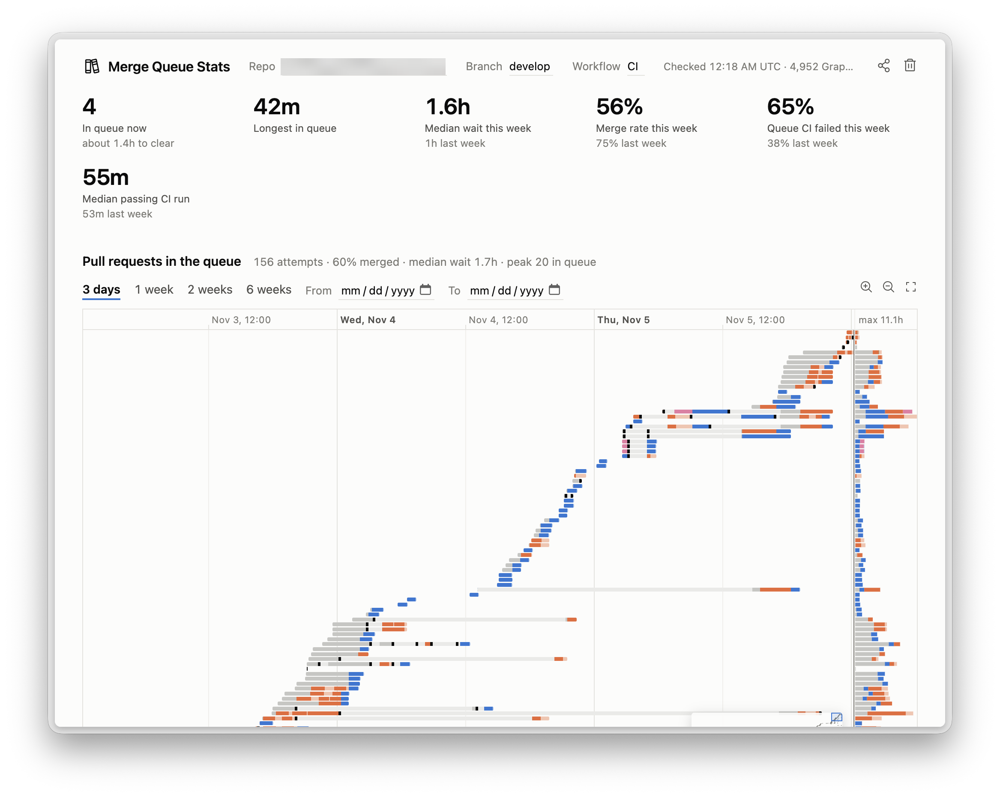
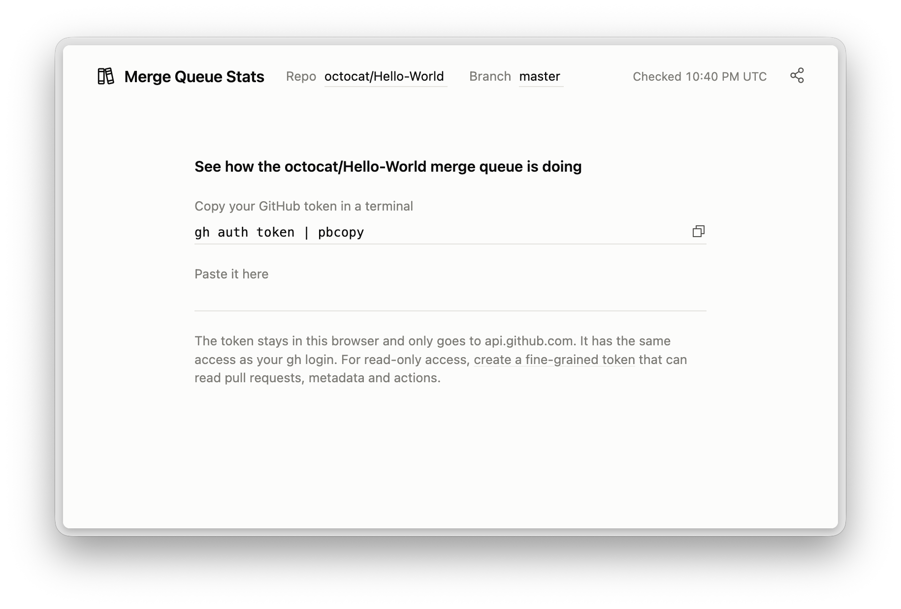

#  Merge Queue Stats



See how a GitHub merge queue is performing: every pull request's time in the queue, CI results, wait times and merge rate.

Open the page, paste a GitHub token and pick a repo. The page talks straight to api.github.com from your browser. There is no server.

## Sharing a view

The share button copies a link with the repo, branch, workflow and date range in the query string. The token is never in the link, so each viewer uses their own.

```
?repo=owner/name&branch=main&days=14
```

## Token



The quickest token is your gh login: run `gh auth token | pbcopy` and paste it into the page. It has the same access as your gh login. For read-only access, create a fine-grained token that can read pull requests, metadata and actions. The token is kept in this browser's localStorage until you press the forget button. On a shared `*.github.io` origin, other project pages on that origin can read localStorage, so prefer a fine-grained, read-only token.

## Develop

```
pnpm install
pnpm dev
pnpm typecheck
pnpm test
```

Pushes to `main` deploy to GitHub Pages.

## License

MIT
